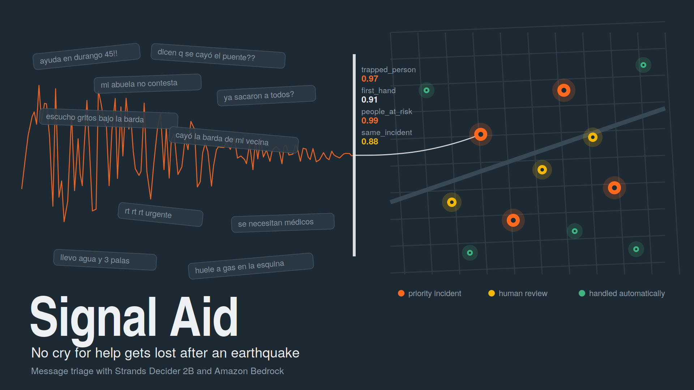

<div align="center">



# Signal Aid

**Earthquake message triage with Strands Decider 2B and Amazon Bedrock**

Built for the **Agent Experience Hackathon: Strands Decider** · `#strands-decider-2b` `#policy`

[](https://github.com/ohmypsychocw/Signal-Aid/actions/workflows/tests.yml)


[Article](#links) · [Demo video](#links) · [Live replay](#links) · [Reusable pattern](patterns/disaster_triage/README.md) · [Notebook](notebooks/signal_aid_demo.ipynb)

</div>

---

After a major earthquake, volunteers receive thousands of mixed messages: real cries for
help, duplicates, offers of help and rumors. Signal Aid is an agent on AWS that turns that
flood into a prioritized incident map, so no cry for help gets lost.

- **[Strands Decider 2B](https://strandsagents.com/blog/introducing-strands-decider/)** makes the fast, calibrated decisions: four typed questions per message in one call, plus duplicate detection.
- **Amazon Bedrock** does the generative work, only for actionable messages: incident briefs.
- A **Strands `InterventionHandler`** puts Decider in the agent's path: nothing is published or merged without its approval. This is the same seam the [official Strands Decider example](https://github.com/strands-labs/strands-decider/tree/main/examples/strands) uses.

## The decision handed to Decider 2B (`#policy`)

Before the agent acts, every message gets four typed questions in a single request:

| Question | Type | Options |
|---|---|---|
| What does this message report? | `choice` | `trapped_person`, `structural_damage`, `gas_leak`, `needs_supplies`, `offers_help`, `not_a_report` |
| Is the author witnessing it in person? | `noul` | true / false |
| How urgent is it? | `score` | 4 levels, from "no risk" to "a life is in danger right now" |
| Does it mention people in danger? | `noul` | true / false (**safety net**, independent of the first question) |

Plain Python then routes the message with **asymmetric thresholds**: a message that may
involve a person in danger is never handled automatically. Decider classifies; the code decides.

```
message ─► Decider 2B: report_type · first_hand · urgency · people_at_risk   (one call)
              │
              ▼
        asymmetric router ──► auto_handle   (harmless, high confidence)
              │          └──► human_review  (unsure, or a person may be in danger)
              ▼
         actionable ──► Strands agent on Amazon Bedrock
                           │  publish_incident / merge_incident / send_to_review
                           ▼
                     TriageGate (InterventionHandler.before_tool_call)
                        · publish only if the route is actionable      → Proceed / Guide
                        · merge only if Decider says same_incident ≥ 0.8 → Proceed / Guide
                           ▼
                     incident map + human review queue
```

## Quickstart

You need a machine with a GPU (an EC2 `g4dn.xlarge` or a SageMaker notebook with a GPU)
and AWS credentials with Amazon Bedrock access. It also runs on CPU, more slowly.

```bash
git clone https://github.com/ohmypsychocw/Signal-Aid && cd Signal-Aid
bash scripts/ec2_setup.sh          # installs strands-decider and serves it on 127.0.0.1:8099
export AWS_REGION=us-east-1

python examples/quickstart.py      # four messages, four decisions, printed as they happen
```

Default models (both can be changed):

| | Default | Override |
|---|---|---|
| Decider checkpoint | `StrandsAgents/strands-decider-2B-qwen3.5-v1-2610` | `CHECKPOINT=...` in `ec2_setup.sh` (for example `strands-decider-2B-hobson-v19`) |
| Decider endpoint | `http://127.0.0.1:8099` | `STRANDS_DECIDER_URL` |
| Bedrock model | `us.anthropic.claude-haiku-4-5-20251001-v1:0` | `BEDROCK_MODEL_ID` |

### Full run

```bash
python -m eval.evaluate --lang en          # questions in English
python -m eval.evaluate --lang es          # questions in Spanish
python -m eval.baseline_llm --price-in <usd per 1M> --price-out <usd per 1M>
python -m signal_aid.pipeline --out web/replay.json
python scripts/build_web.py --out docs/index.html
```

Or open [`notebooks/signal_aid_demo.ipynb`](notebooks/signal_aid_demo.ipynb) and run it top to bottom.

| Command | Decider | Bedrock | Use |
|---|---|---|---|
| `python -m signal_aid.pipeline` | real | on | the real run |
| `python -m signal_aid.pipeline --no-llm` | real | off | template briefs, Decider still decides |
| `python -m signal_aid.pipeline --mock-decider --no-llm` | **mock keyword rules** | off | UI development and CI only; the demo shows a warning |

Never report mock numbers as results.

## Reusable decision pattern

[`patterns/disaster_triage/`](patterns/disaster_triage/README.md) is self-contained and only
needs `strands-agents` and `pyyaml`:

| Part | File |
|---|---|
| Standard-library Decider client with `noul` / `choice` / `score` builders | `decider.py` |
| Typed questions and option sets (English and Spanish) | `questions.py` |
| Answer parsing and asymmetric routing | `router.py` |
| The wiring: `TriageGate`, a Strands `InterventionHandler` | `handler.py` |
| Thresholds, with the reason for each | `thresholds.yaml` |

Adapt it to floods, fires or hurricanes in three steps: see its README.

## Results

Measured on ⟦FILL: N⟧ labeled synthetic messages. Full tables: `eval/results_en.md`,
`eval/results_es.md` and `eval/baseline.md`.

| Metric | Result |
|---|---|
| Report-type accuracy | ⟦FILL⟧ |
| **Safety recall** (people at risk never auto-handled) | ⟦FILL⟧ |
| Bedrock invocations avoided | ⟦FILL⟧ |
| Decider latency p50, four questions | ⟦FILL⟧ |

## Running on AWS

| Piece | Service |
|---|---|
| Decider 2B server (localhost only, no authentication) | Amazon EC2 with GPU, or a SageMaker notebook |
| Agent | Python on the same instance, with Strands Agents |
| Generative steps | Amazon Bedrock |
| Replay demo | Amazon S3 + Amazon CloudFront (`scripts/deploy_web.sh`), or GitHub Pages from `docs/` |

The replay page is a recording of a real run, so it works even when the GPU is off. It
says when the run happened and which models were used, and it warns when the data is mock.

## Repository layout

| Path | What it is |
|---|---|
| `patterns/disaster_triage/` | **The reusable decision pattern** |
| `signal_aid/` | The agent: incident store, Bedrock agent, pipeline, mock Decider for UI work |
| `examples/quickstart.py` | The whole idea in one screen |
| `data/` | 36 labeled synthetic messages, a Bedrock generator for more, and the schematic basemap |
| `eval/` | Evaluation of the pattern and the Bedrock LLM baseline |
| `notebooks/signal_aid_demo.ipynb` | Step-by-step walkthrough for SageMaker or Jupyter |
| `web/`, `scripts/build_web.py`, `docs/` | The replay demo, built into one static file |
| `scripts/` | EC2 setup and S3 deployment |
| `tests/` | Offline tests, run by GitHub Actions |

## Honest limits

- All messages are synthetic and fictional. Signal Aid was not tested with real emergency data.
- Decider 2B is an experimental model, and adversarial text can sway a small classifier. Signal Aid recommends and routes; humans make the final call.
- Thresholds come from a small labeled set and must be re-tuned for new data.
- In this demo, coordinates come with each synthetic message. Real use would need the sender's location or geocoding.
- Signal Aid is a support tool for volunteers. It does not replace civil protection authorities.

## Links

- 📝 Article on AWS Builder Center: ⟦FILL⟧
- 🎬 Demo video (under 3 minutes): ⟦FILL⟧
- 🌐 Live replay: https://ohmypsychocw.github.io/Signal-Aid/

## Acknowledgements and license

Signal Aid is licensed under Apache-2.0 ([LICENSE](LICENSE)). The Decider client and the
intervention wiring follow the shape of the official
[strands-labs/strands-decider](https://github.com/strands-labs/strands-decider) examples
(Apache-2.0). Strands Decider 2B and Amazon Bedrock are subject to their own license and
service terms.
